<!-- Images are drawn by .github/readme/build.py (the hero is shots/dashboard.png when present): `uv run .github/readme/build.py`.
     Drop screenshots in .github/readme/shots/ and run it again to frame them. -->

<p align="center">
  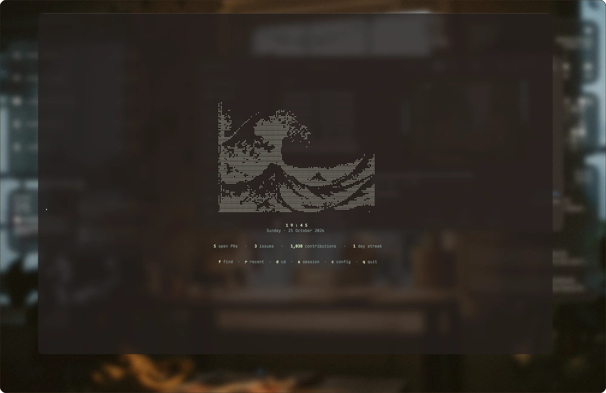
</p>

<p align="center">
  <b>A quiet, transparent Neovim</b> that reads PDFs in a split, runs notebooks, keeps Claude in ordinary buffers<br>
  and lets the terminal's glass show through every one of its nineteen colour schemes.
</p>

<p align="center"><sub>Neovim 0.11 · lazy.nvim · 70 plugin specs · 7.5k lines of Lua · macOS + kitty</sub></p>

<p align="center"><a href="#pdfs-in-a-split-drawn-by-kitty"></a><a href="#claude-chats-are-buffers">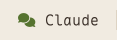</a><a href="#terminals-that-know-what-they-ran">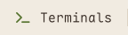</a><a href="#notebooks-in-plain-text"></a><a href="#nineteen-schemes-one-rule">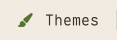</a><a href="#anatomy"></a><a href="#keys"></a><a href="#install">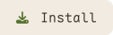</a></p>

<br>

Most of this is a careful arrangement of good plugins. A few parts are written from scratch because nothing else did them the way I wanted: a PDF viewer drawn with kitty graphics, Claude sessions that live in buffers, terminals that remember what they ran, and a transparency system that every theme obeys. The editor itself stays out of the way, with earthy colours, one accent and no chrome you didn't ask for.

<p align="center">
  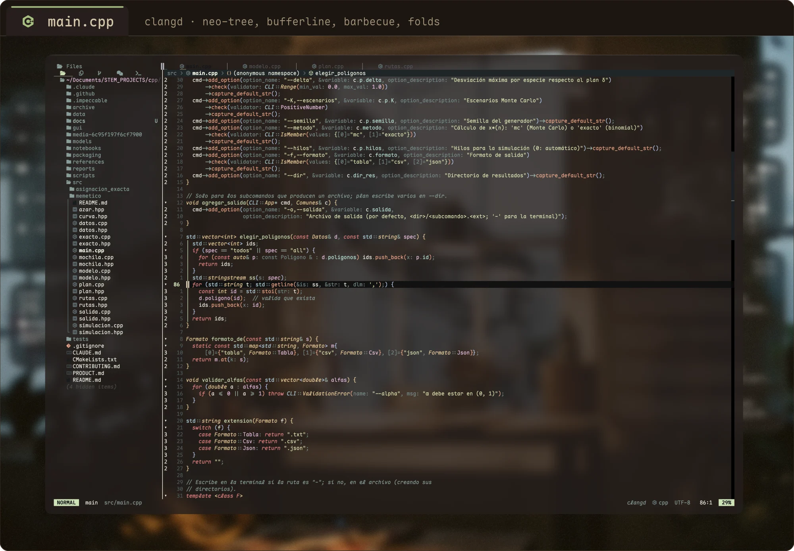
</p>

<br>

## PDFs in a split, drawn by kitty

`lua/pdfview/` renders PDFs inside Neovim with the kitty graphics protocol, so there's no second window to manage. The pages take on your theme: ink becomes the editor's foreground and paper becomes the terminal's glass, while raster figures keep their real colours.

<p align="center">
  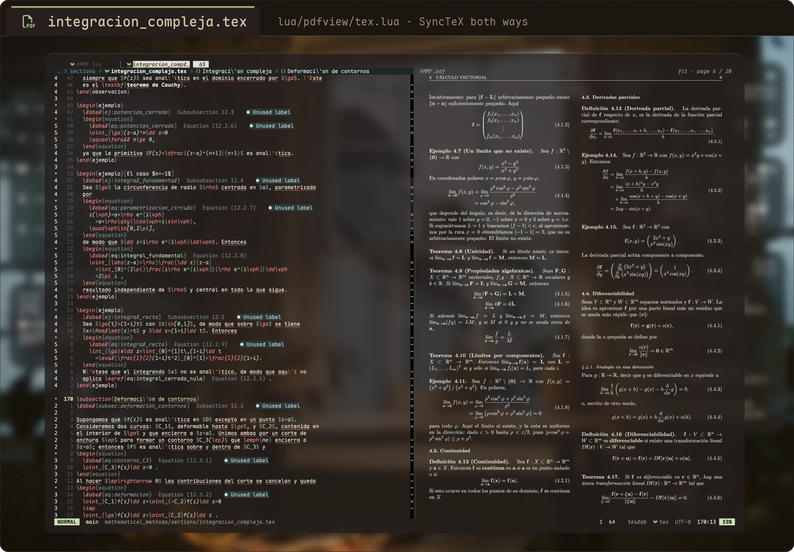
</p>

**LaTeX.** <kbd>␣ l v</kbd> opens the compiled PDF next to the source, sized to the page's aspect ratio. SyncTeX works in both directions: the cursor's line is boxed on the page, and clicking a word on the page jumps to its line. <kbd>␣ l F</kbd> keeps following you as you type and recompile. VimTeX drives compilation, Skim is one key away (<kbd>␣ l V</kbd>), and a Castel-style snippet set handles math as you write.

**Markdown.** <kbd>␣ p v</kbd> pipes the buffer through pandoc and typst with a GitHub-flavoured template. The page is cut to the shape of the split, so text reflows when you resize it and <kbd>j</kbd> <kbd>k</kbd> move screen to screen. It re-renders as you type. Without SyncTeX, both directions match text instead.

<p align="center">
  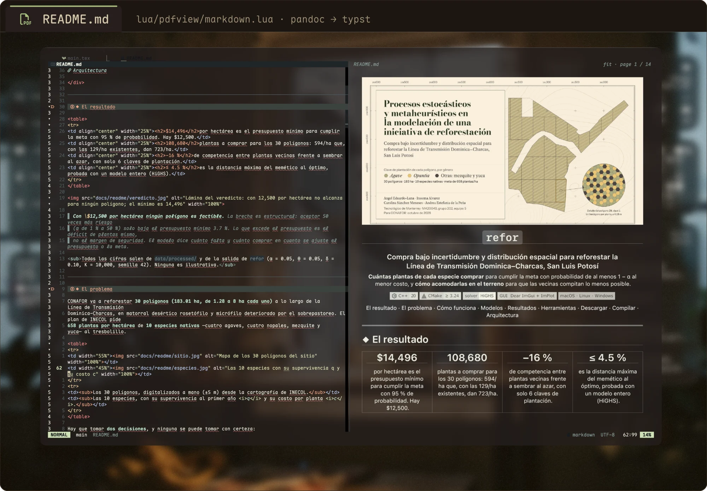
</p>

<details>
<summary><b>How a page gets to the screen</b></summary>
<br>

Each page is rasterised once per zoom level by `pdftoppm`, recoloured by ImageMagick and kept as a memory-mapped `.mpc` file. Every redraw only crops the visible part out of those into one PNG the size of the window, which takes about 0.15 s instead of the 0.6 s a fresh rasterise costs at retina sizes. The next view is prefetched. Search uses `pdftotext -bbox` word boxes, links come from `pdftohtml -xml`, and per-file page, zoom and spread are remembered across sessions. Any `.pdf` you `:edit` opens the same way.

</details>

<br>

## Claude chats are buffers

`lua/claude_chats/` runs `claude` in ordinary terminal buffers, as many as you like, side by side or in the background. Each one gets the same environment that claudecode.nvim gives its own split, so diffs, selections and diagnostics still flow through the IDE integration.

<p align="center">
  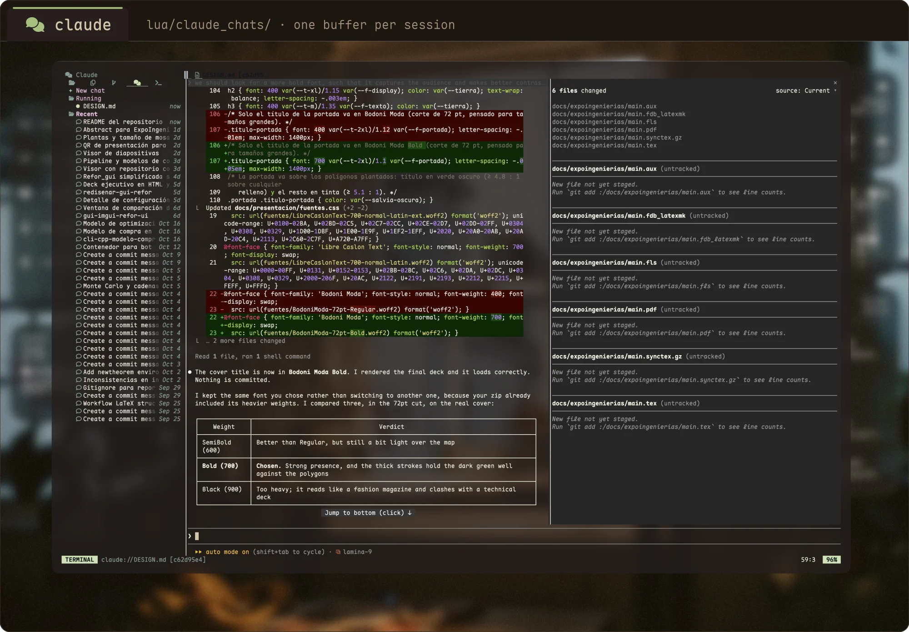
</p>

Past sessions are read straight from `~/.claude/projects/` and listed in a neo-tree tab under their own titles. Running chats are matched to their logs by a pre-assigned session id. <kbd>␣ a n</kbd> starts a chat, <kbd>␣ a R</kbd> resumes one and <kbd>␣ a l</kbd> opens the list, while <kbd>␣ a c</kbd> still toggles the classic claudecode split.

<br>

## Terminals that know what they ran

Shells start through a small `ZDOTDIR` wrapper that loads your real zsh config unchanged, then emits the standard OSC marks around every command. In return, `lua/terminals/` knows each shell's directory, the command it's running, the last one it finished, its exit status, and exactly which rows its output occupies.

<p align="center">
  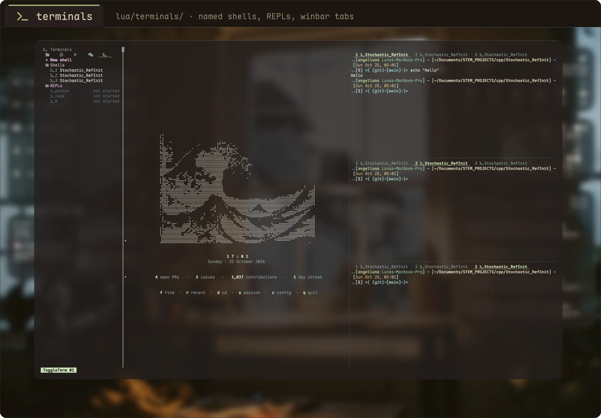
</p>

<dl>
  <dt><kbd>␣ t q</kbd> &ensp;last output → quickfix</dt>
  <dd>Compiler errors become a jump list, with paths resolved against that shell's directory, not Neovim's.</dd>
  <dt><kbd>␣ t r</kbd> &ensp;run it again</dt>
  <dd>Re-runs the last command in the last terminal you used.</dd>
  <dt><kbd>␣ t s</kbd> &ensp;pick a terminal</dt>
  <dd>Telescope with a scrollback preview. Every shell's name, command and exit code also show in its winbar and in neo-tree's Terminals tab.</dd>
  <dt><kbd>␣ t p</kbd> <kbd>␣ t N</kbd> <kbd>␣ t R</kbd> &ensp;REPLs</dt>
  <dd>Pinned Python, Node and R. <kbd>␣ t l</kbd> sends a line or selection, and Python 3.13's REPL gets bracketed paste.</dd>
</dl>

Terminals are saved with the session and come back in the same directories.

<br>

## Notebooks in plain text

`.ipynb` files open as Markdown through jupytext and run cell by cell in real Jupyter kernels through molten.nvim. In kitty, plots appear inline. Quarto documents get LSP inside every chunk via otter.nvim, and R runs through the same kernel machinery as Python.

<p align="center">
  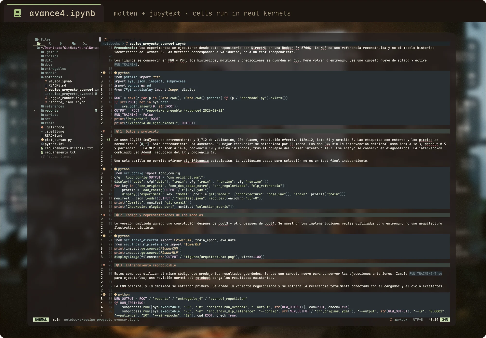
</p>

<kbd>␣ m i</kbd> picks a kernel. <kbd>␣ r c</kbd> runs the cell under the cursor, <kbd>␣ r a</kbd> runs them all, and <kbd>␣ r k</kbd> / <kbd>␣ r j</kbd> run everything above or below. A small `jkernel` helper registers a project's venv as a kernel in one command. The full workflow is in [`docs/molten.md`](docs/molten.md).

<br>

## Nineteen schemes, one rule

Every colour scheme draws without an editor background, so the terminal's translucent glass shows through. A single autocmd enforces it for schemes that have no transparency option of their own. Accents across the UI (the lualine blocks, the cursorline number, the dashboard clock) come from the active scheme's `Function` colour, so nothing is hard-coded and every theme looks deliberate.

<p align="center">
  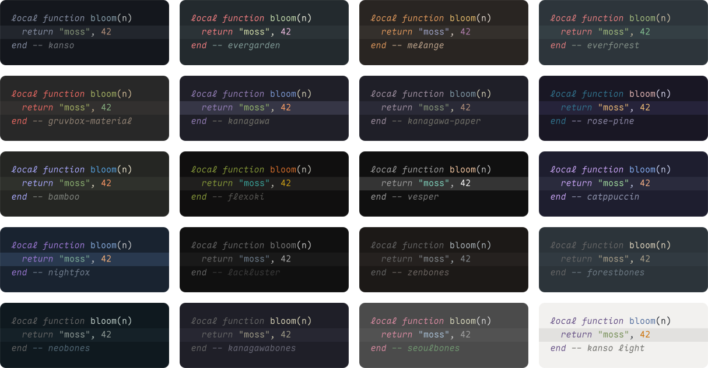
</p>
<p align="center"><sub>Drawn from each scheme's real highlight groups, read out of a headless Neovim.</sub></p>

<kbd>␣ c s</kbd> picks a scheme with live preview and remembers it. The glass is the default and the point, but <kbd>␣ u b</kbd> turns it solid when a scheme deserves its own background. In Alacritty the window's opacity follows along and resets when Neovim exits.

<details>
<summary><b>The small things</b></summary>
<br>

<dl>
  <dt>A cursorline only where you are</dt>
  <dd>It shows in the focused file window only, never in terminals, floats or Zen mode. <kbd>␣ u c</kbd> cycles it between number, underline and a blended band.</dd>
  <dt><code>:q</code> closes the buffer</dt>
  <dd>In the last window you get the next buffer, or the dashboard. <code>:q</code> on the dashboard leaves Neovim. Unsaved buffers ask Save / Discard / Cancel.</dd>
  <dt>Motion over fades</dt>
  <dd>A terminal cell is either a colour or glass, so animations move rather than fade: a stiff smear cursor, 140 ms eased scrolling, a short glimmer on yank, notifications that slide.</dd>
  <dt>A dashboard that's actually live</dt>
  <dd>The clock ticks only while the dashboard is visible. The stats line comes from one cached GitHub GraphQL call, so it never blocks startup.</dd>
  <dt>And for breaks</dt>
  <dd><kbd>␣ f m l</kbd> makes the code rain, and <kbd>␣ t y</kbd> opens a typing trainer.</dd>
</dl>

</details>

<br>

## Anatomy

<p align="center">
  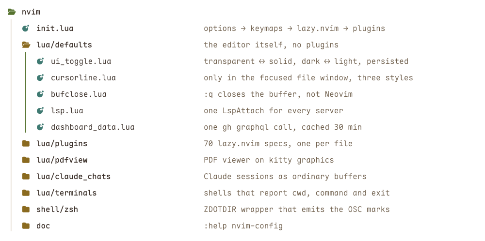
</p>

Plugins are one file each under `lua/plugins/`, and lazy.nvim imports the whole directory, so adding a plugin means adding a file. Language servers are installed by Mason and set up with Neovim 0.11's native `vim.lsp.config`. A single `LspAttach` autocmd binds the same keys for every server.

<br>

## Keys

Leader is <kbd>Space</kbd> (written <kbd>␣</kbd> here) and localleader is <kbd>\\</kbd>. <kbd>␣ ?</kbd> searches every mapping, and <kbd>␣ k</kbd> opens a cheatsheet.

| Keys | Does |
|:--|:--|
| <kbd>␣ f f</kbd> &ensp; <kbd>␣ n</kbd> | Find files &ensp;·&ensp; toggle neo-tree |
| <kbd>Tab</kbd> <kbd>S-Tab</kbd> &ensp; <kbd>␣ x</kbd> | Next / previous buffer &ensp;·&ensp; close buffer, keep the window |
| <kbd>gd</kbd> <kbd>gr</kbd> <kbd>gi</kbd> <kbd>gy</kbd> &ensp; <kbd>K</kbd> | Definition, references, implementation, type &ensp;·&ensp; peek fold, else hover |
| <kbd>␣ r n</kbd> &ensp; <kbd>␣ c a</kbd> &ensp; <kbd>[d</kbd> <kbd>]d</kbd> | Rename &ensp;·&ensp; code action &ensp;·&ensp; previous / next diagnostic |
| <kbd>C-\\</kbd> &ensp; <kbd>␣ t n</kbd> &ensp; <kbd>␣ t s</kbd> | Last terminal &ensp;·&ensp; new shell &ensp;·&ensp; terminal picker |
| <kbd>␣ a n</kbd> &ensp; <kbd>␣ a l</kbd> &ensp; <kbd>␣ a c</kbd> | New Claude chat &ensp;·&ensp; chat list &ensp;·&ensp; claudecode split |
| <kbd>␣ l l</kbd> &ensp; <kbd>␣ l v</kbd> &ensp; <kbd>␣ p v</kbd> | Compile LaTeX &ensp;·&ensp; PDF preview &ensp;·&ensp; Markdown preview |
| <kbd>␣ m i</kbd> &ensp; <kbd>␣ r c</kbd> &ensp; <kbd>␣ r a</kbd> | Start kernel &ensp;·&ensp; run cell &ensp;·&ensp; run all |
| <kbd>␣ c s</kbd> &ensp; <kbd>␣ u b</kbd> &ensp; <kbd>␣ u B</kbd> | Colour scheme &ensp;·&ensp; transparent ↔ solid &ensp;·&ensp; dark ↔ light |
| <kbd>␣ z</kbd> &ensp; <kbd>␣ u h</kbd> &ensp; <kbd>␣ u f</kbd> | Zen mode &ensp;·&ensp; inlay hints &ensp;·&ensp; format on save |
| <kbd>␣ d b</kbd> &ensp; <kbd>␣ d c</kbd> &ensp; <kbd>␣ d u</kbd> | Breakpoint &ensp;·&ensp; continue &ensp;·&ensp; debugger UI |
| <kbd>␣ q q</kbd> | Quit Neovim |

Every mapping is documented in `:help nvim-keymaps`.

<br>

## Install

```sh
git clone https://github.com/Lunaaaalj/nvim ~/.config/nvim
nvim   # lazy.nvim bootstraps itself; Mason installs servers, formatters and debuggers
```

<details>
<summary><b>What it expects on the machine</b></summary>
<br>

| For | Needs |
|:--|:--|
| **Always** | Neovim 0.11+, git, `make` (telescope-fzf-native), `lazygit` |
| **PDF viewer** | `brew install poppler imagemagick`, plus `pandoc typst` for the Markdown preview |
| **Graphics** | kitty, WezTerm or Ghostty for the PDF viewer and inline plots. Alacritty runs everything else |
| **Notebooks** | a `~/.virtualenvs/neovim` venv with `pynvim jupyter_client jupytext`, then `:UpdateRemotePlugins` |
| **R / Quarto** | `brew install r quarto`, then `IRkernel::installspec()` once in R |
| **Dashboard stats** | `gh auth login`. Without it, the stats line simply doesn't appear |
| **LaTeX** | a TeX distribution with `latexmk`. Skim is optional, as an external viewer |

</details>

<details>
<summary><b>Every plugin, by job</b></summary>
<br>

| Job | Plugins |
|:--|:--|
| **Core** | lazy.nvim, nvim-lspconfig, mason (+ lspconfig, tool-installer), nvim-cmp, LuaSnip, conform.nvim, nvim-treesitter (+ context, textobjects) |
| **Moving around** | telescope (+ fzf-native), neo-tree, oil.nvim, harpoon, flash.nvim, grug-far, which-key |
| **Editing** | nvim-surround, Comment.nvim, mini.ai, treesj, nvim-ufo, nvim-autopairs, todo-comments |
| **Interface** | lualine, bufferline, noice + nvim-notify, barbecue + navic, snacks (dashboard, scroll), satellite, mini.indentscope, illuminate, rainbow-delimiters, colorizer, tiny-devicons |
| **Motion** | smear-cursor, tiny-glimmer, precognition |
| **Git** | lazygit.nvim, gitsigns, diffview, git-conflict |
| **Test & debug** | neotest (pytest), nvim-dap + dap-ui (Python, C/C++), trouble.nvim |
| **Writing** | VimTeX, render-markdown, zen-mode + twilight, hover.nvim |
| **Notebooks** | molten.nvim, jupytext.nvim, image.nvim, quarto-nvim, otter.nvim |
| **Sessions & AI** | persistence.nvim, toggleterm, claudecode.nvim |
| **Schemes** | kanso, evergarden, melange, everforest, gruvbox-material, kanagawa, kanagawa-paper, rose-pine, bamboo, flexoki, vesper, catppuccin, nightfox, lackluster, zenbones (+ forest/neo/kanagawa/seoul bones) |
| **Breaks** | cellular-automaton, typr |

</details>

<br>

Everything above is written down properly inside the editor: `:help nvim-config`, `:help nvim-keymaps`, `:help nvim-plugins` and `:help nvim-notebooks`.

<br>

<p align="center">
  
</p>
